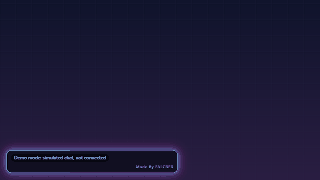

# Neon Stream Overlay

A free neon chat overlay for OBS Browser Source. There is no backend, no account and no login: the page runs in OBS and reads public Twitch chat directly.

**[Live demo and link generator](https://berkantshn.github.io/neon-stream-overlay/)** | [Türkçe](#türkçe)



*Recorded from demo mode with simulated chat. The grid behind the box is added for the recording, because the overlay background is transparent.*

## Features

- **Neon chat box** with five themes, custom colours, position, size and panel opacity
- **Safe text:** messages are shown as plain text only, never as HTML, with a length limit and removal of invisible and direction-changing characters
- **Message emphasis:** glow for burst triggers, highlight words, mentions of your channel and first-time chatters
- **Event bursts:** particles, rings and a big label on `!hype` or your own commands and keywords, with a cooldown
- **Mod control:** limit bursts to mods and the broadcaster, and optionally let mods add keywords live
- **Moderation aware:** messages that mods delete on Twitch also disappear from the overlay
- **Comfort and performance:** a reduced-motion option that also follows the system setting, and a low-quality option
- **Demo mode:** simulated chat that connects to nothing
- **Small:** about 5 KB of gzipped JavaScript and no runtime dependencies

## Add it to OBS

1. Open the [setup page](https://berkantshn.github.io/neon-stream-overlay/), turn **Demo mode** off and enter your Twitch channel name.
2. Pick your colours and effects, then press **Copy link**.
3. In OBS: **Sources**, **+**, **Browser**, **Create new**.
4. Paste the link into **URL**. Set the width to `450` and the height to `800`, or to any size you like.
5. Leave **Custom CSS** as it is. The background stays transparent.

To change a setting later, build a new link and replace the old one. Never add a password or token to the link. The overlay does not need one, and it shows a warning if it finds one.

## Settings

The setup page writes these for you. They are listed here for manual editing.

| Parameter | Values | Default | Meaning |
| --- | --- | --- | --- |
| `demo` | `0` `1` | `0` | Simulated chat. Turns off real connections |
| `twitch` | channel name | none | Twitch channel to read |
| `theme` | `cyber` `magma` `toxic` `ice` `synth` | `cyber` | Colour preset |
| `c1`, `c2` | `#rrggbb` | theme | Custom colours |
| `panel` | `0`-`100` | `70` | Panel opacity in percent |
| `font` | `12`-`40` | `18` | Text size in pixels |
| `w` | `240`-`1600` | `420` | Box width in pixels |
| `pos` | `bl` `br` `tl` `tr` | `bl` | Screen corner |
| `max` | `3`-`50` | `12` | Messages on screen |
| `fade` | `0`-`600` | `0` | Remove messages after this many seconds. `0` keeps them |
| `maxlen` | `20`-`500` | `200` | Maximum characters per message |
| `ignore` | comma list | none | Users to hide, such as bots |
| `hidecmd` | `0` `1` | `0` | Hide burst commands from the chat box |
| `hidelinks` | `0` `1` | `0` | Replace links with `[link]` |
| `commands` | comma list | `!hype` | Commands that trigger a burst |
| `keywords` | comma list | none | Words that trigger a burst |
| `highlights` | comma list | none | Words that glow without a burst |
| `fxby` | `all` `mods` | `all` | Who can trigger bursts |
| `cooldown` | `0`-`300` | `8` | Minimum seconds between bursts |
| `modkw` | `0` `1` | `0` | Let mods use `!neonkw add word`, `!neonkw del word` and `!neonkw clear` |
| `motion` | `auto` `reduced` | `auto` | Reduced motion. `auto` follows the system setting |
| `quality` | `high` `low` | `high` | `low` uses fewer particles and no glow shadows |
| `credit` | `0` `1` | `1` | Small credit on the overlay |
| `status` | `0` `1` | `1` | Connection status label |

Lists hold up to 20 items of up to 32 characters each. Keywords added with `!neonkw` last until the page reloads.

## Limits

**Twitch**

- Chat is read over Twitch's IRC WebSocket with an anonymous `justinfan` login. It is read-only, and the overlay never sends a chat message.
- This anonymous login is long-standing community knowledge, but Twitch's current documentation does not describe it, and Twitch prefers EventSub for new chat integrations. Twitch could change or end it at any time.
- There are no subscription, raid, bit or follow alerts in v1. Those need authenticated APIs.
- Emotes appear as their text name, such as `Kappa`. No images load from outside.
- Chat history is not shown. Messages appear from the moment the overlay connects.

**Other platforms**

- Kick is not supported yet; a compliant version is planned.

**In general**

- The link holds your settings in plain text. It holds no secrets, because the overlay needs none.
- Very busy chats are rate-limited on screen, and the oldest waiting messages are dropped.
- This project is not affiliated with Twitch.

## Privacy and security

- There is no server, analytics, cookies or third-party script. Your browser or OBS connects straight to the chat service.
- A strict Content Security Policy allows only the Twitch socket.
- Chat text and names are written with `textContent`, so markup in a message stays visible text. Automated tests cover this.

## Development

Requires Node.js 22.12 or newer and [pnpm](https://pnpm.io).

```bash
pnpm install
pnpm dev      # local server. Open /overlay.html?demo=1
pnpm test     # sanitizer, parser, config and adapter tests
pnpm build    # static site in dist/
```

The contents of `dist/` work on any static host. The included workflow publishes them to GitHub Pages from `main`.

---

# Türkçe

OBS Browser Source için ücretsiz neon sohbet katmanı (overlay). Sunucu, hesap veya giriş gerektirmez: sayfa OBS içinde çalışır ve herkese açık Twitch sohbetini doğrudan okur.

**[Canlı demo ve bağlantı oluşturucu](https://berkantshn.github.io/neon-stream-overlay/)**

## Özellikler

- **Neon sohbet kutusu:** beş tema, özel renkler, konum, boyut ve panel saydamlığı
- **Güvenli metin:** mesajlar HTML olarak değil yalnızca düz metin olarak gösterilir; uzunluk sınırı vardır, görünmez ve yön değiştiren karakterler silinir
- **Mesaj vurgusu:** tetikleyiciler, vurgu kelimeleri, kanalınızdan bahsedenler ve ilk kez yazanlar parlar
- **Patlama efektleri:** `!hype` veya kendi komut ve kelimelerinizle parçacık, halka ve büyük yazı; bekleme süresi ayarlanabilir
- **Moderatör kontrolü:** efektleri moderatör ve yayıncıyla sınırlayabilir, isterseniz moderatörlerin canlıda kelime eklemesine izin verebilirsiniz
- **Moderasyona uyum:** Twitch'te moderatörün sildiği mesaj overlay'den de kalkar
- **Konfor ve performans:** sistem ayarına da uyan hareket azaltma seçeneği ve düşük kalite seçeneği
- **Demo modu:** hiçbir yere bağlanmayan simüle sohbet
- **Küçük boyut:** yaklaşık 5 KB sıkıştırılmış JavaScript, çalışma anında bağımlılık yok

## OBS'e ekleme

1. [Kurulum sayfasını](https://berkantshn.github.io/neon-stream-overlay/) açın, **Demo mode** seçeneğini kapatın ve Twitch kanal adınızı yazın.
2. Renk ve efektleri seçip **Copy link** düğmesine basın.
3. OBS'te: **Kaynaklar**, **+**, **Tarayıcı**, **Yeni oluştur**.
4. Bağlantıyı **URL** alanına yapıştırın. Genişliği `450`, yüksekliği `800` yapın veya istediğiniz boyutu girin.
5. **Özel CSS** alanını olduğu gibi bırakın. Arka plan saydam kalır.

Bir ayarı sonradan değiştirmek için yeni bağlantı oluşturup eskisiyle değiştirin. Bağlantıya asla parola veya token eklemeyin. Overlay'in buna ihtiyacı yoktur, böyle bir değer görürse uyarı gösterir.

Tüm URL parametreleri yukarıdaki [Settings](#settings) tablosundadır. Kurulum sayfası bunları sizin yerinize yazar.

## Sınırlar

**Twitch**

- Sohbet, Twitch'in IRC WebSocket bağlantısından anonim `justinfan` girişiyle okunur. Yalnızca okuma yapılır, overlay sohbete hiçbir mesaj göndermez.
- Bu anonim giriş topluluk tarafından uzun süredir bilinir, ancak Twitch'in güncel belgelerinde anlatılmaz ve Twitch yeni sohbet entegrasyonları için EventSub'ı önerir. Twitch bunu her an değiştirebilir veya kapatabilir.
- v1'de abonelik, raid, bit ve takip bildirimi yoktur. Bunlar kimlik doğrulamalı API gerektirir.
- Emote'lar `Kappa` gibi metin adıyla görünür. Dışarıdan görsel yüklenmez.
- Sohbet geçmişi gösterilmez. Mesajlar overlay bağlandığı andan itibaren görünür.

**Diğer platformlar**

- Kick henüz desteklenmiyor; kurallara uygun bir sürüm planlanıyor.

**Genel**

- Bağlantı, ayarlarınızı düz metin olarak taşır. Gizli bilgi içermez, çünkü overlay'in buna ihtiyacı yoktur.
- Çok yoğun sohbetlerde ekrana yazma hızı sınırlanır ve sırada bekleyen en eski mesajlar atılır.
- Bu proje Twitch ile bağlantılı değildir.

## Gizlilik ve güvenlik

- Sunucu, analitik, çerez veya üçüncü taraf script yoktur. Tarayıcınız ya da OBS doğrudan sohbet servisine bağlanır.
- Sıkı bir Content Security Policy yalnızca Twitch soketine izin verir.
- Sohbet metni ve kullanıcı adları `textContent` ile yazılır, yani mesajdaki işaretleme görünür metin olarak kalır. Otomatik testler bunu doğrular.

## Geliştirme

Node.js 22.12 veya üstü ve [pnpm](https://pnpm.io) gerekir.

```bash
pnpm install
pnpm dev      # yerel sunucu. /overlay.html?demo=1 adresini açın
pnpm test     # temizleyici, çözücü, ayar ve adaptör testleri
pnpm build    # dist/ içinde statik site
```

`dist/` içeriği her statik barındırmada çalışır. Projedeki iş akışı bunu `main` dalından GitHub Pages'e yayınlar.

## ⭐ Support this project

If this project helped you, please give it a ⭐ and [follow me on GitHub](https://github.com/berkantshn) for more.

İşine yaradıysa projeye ⭐ verip [beni GitHub'da takip edebilirsin](https://github.com/berkantshn).

---

MIT License. Made By FALCREB
